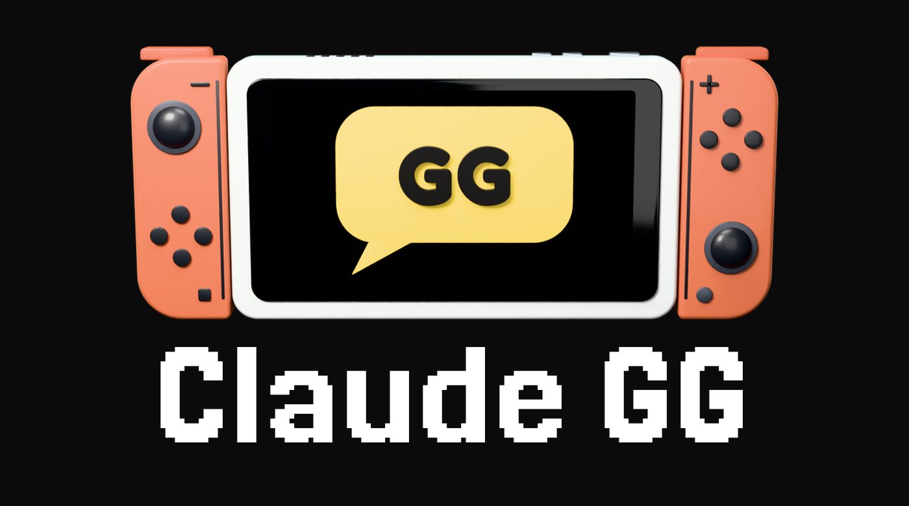

# Claude GG

Game automation for any console, starting with the Nintendo Switch. Run programs, or build and fix them with Claude.

A program of Claude GG plays a game by itself. It watches the game through a capture card and presses the buttons through a controller board (for example an ESP32). For now that is the Nintendo Switch, and most programs are for Pokémon games; the aim is every console a program can watch and press the buttons of (see [ROADMAP.md](ROADMAP.md)). Claude, in a panel of the main window, answers questions about the programs and can change their source, on a branch of its own that becomes a pull request.

It is a personal fork of [Pokémon Automation](https://github.com/PokemonAutomation/Arduino-Source)'s "SerialPrograms", with a new interface, a program that plays the whole story of FireRed and LeafGreen, Claude built in, and fixes of its own. The programs for the other games are those of Pokémon Automation.

Claude GG is not made, endorsed or supported by Nintendo, Game Freak, Creatures or The Pokémon Company, nor by Anthropic or the Pokémon Automation project. Please do not ask the Pokémon Automation team for help with this fork: use the [issues of this repository](https://github.com/MajorLOL/ClaudeGG/issues).

## Getting it

Every push to the branch `main` makes a Windows build and tests that it starts. A build that passes is published under [releases](https://github.com/MajorLOL/ClaudeGG/releases). Unzip `ClaudeGG-Windows.zip` and run `ClaudeGG.exe`.

To keep the settings of an older build, close it and copy its `UserSettings` folder into the new folder. The hardware and its setup are the same as for Pokémon Automation: see [its documentation](https://pokemonautomation.github.io/).

## What is different from Pokémon Automation

| | |
|---|---|
| **Interface** | A new window made of the screens of the setup: the games, the programs of a game (with the live picture, the checks, the log and the options) and the program itself. Two themes of its own, Night and Day, in the color of a starter; the old looks are still there as "Classic". |
| **Claude** | A panel where you talk to Anthropic's Claude, on an API key of your own. It answers questions about the programs and builds or fixes them: every change goes to a `claude/...` branch and a pull request that is built and tested before you merge it. The program **Claude Plays**, in the list of every game, lets Claude play toward a goal you write down, on your API key or, without a key, through a Claude Code of your own that calls the program's tools. See [ASSISTANT.md](SerialPrograms/Source/ClaudeGG/ASSISTANT.md). |
| **Intro** | A short film at startup. Settings or `--no-intro` turns it off. |
| **Installations** | Several installations run side by side, each in its own window and process, with its own settings, capture card and microcontroller. An overview shows a miniature of each. |
| **FRLG AutoStory** | Plays FireRed or LeafGreen from a new game to the Hall of Fame and on, up to a Pokédex collection. See [the program's folder](SerialPrograms/Source/VideoGames/PokemonFRLG/Programs/AutoStory). |
| **Experimental programs** | New programs and options that have not run on a console yet carry the tag "experimental". What each is for and how far it was tested: [ROADMAP.md](ROADMAP.md), sections 6 and 7. |
| **Search** | The games and the programs of a game have a search field; just start typing. |
| **Fixes** | Fixes for bugs found in a review of the whole code: [FIXES.md](SerialPrograms/Source/ClaudeGG/FIXES.md). Pokémon Automation's open issues and where this fork stands on each: [ISSUES.md](SerialPrograms/Source/ClaudeGG/ISSUES.md), [OTHERS.md](SerialPrograms/Source/ClaudeGG/OTHERS.md). |
| **Video frames** | Pictures of the screen are made without Qt's `QVideoFrame::toImage()`, which on some computers grows the memory by up to 1.6 GB an hour. |
| **Builds** | Each build starts once on the build machine, as on a computer that never ran it, goes through its pages and saves a picture of each. A build that fails is not published. |
| **Left out** | The check for a new version (it is for Pokémon Automation's releases), Discord Rich Presence by default, and the Discord bot and Social SDK in the Windows build. |

Everything that differs from Pokémon Automation, with the reason for each change and the faults of the original that were found and fixed: [CHANGES.md](CHANGES.md); every file that differs: [CHANGED-FILES.md](CHANGED-FILES.md). How to set this repository up on GitHub: [GITHUB-SETUP.md](GITHUB-SETUP.md). What is planned: [ROADMAP.md](ROADMAP.md).

## Building

Claude GG builds like Pokémon Automation's SerialPrograms: see [SerialPrograms/BuildInstructions](SerialPrograms/BuildInstructions). The Windows builds are made by [this workflow](.github/workflows/claudegg-windows.yml) with Qt 6.10.2.

`SerialPrograms --ui-screenshots <folder>` starts the program, saves a picture of each page and exits; nothing is pressed on a console and no setting is saved. Its exit code is 0 when every picture was taken and every check passed. The other tests are `--language-test`, `--setup-test <folder>`, `--tutorial-test`, `--installation <name> --installation-test` and `--installations-hub-test <folder>`; the Windows workflow runs them all.

## Language and setup

The first start goes through a setup in the style of the intro: the **language**, the **console** and the **microcontroller**, then the **game** and the **program** to start. Menus wait for your choice (mouse or keyboard). Settings can open the setup again.

- **Language.** English is the default. Dutch, German, French and Spanish come with the program; **Other** reads your own file, `Languages/custom.json`. A language applies at once and can be changed in Settings.
- **Console.** Nintendo Switch or Switch 2, an Android phone, a **PlayStation 3**, an **original Xbox**, the **retro consoles** through BlueRetro, a modified **Xbox 360**, a **PS4 or PS5** or an **Xbox One or Series** through Remote Play, an **iPhone**, a **PlayStation Classic** or a **Nintendo Wii U** (all of these experimental). For the Switch the choice is only kept; the programs detect the console themselves.
- **PlayStation 3 (experimental, not tried on a PlayStation 3 yet).** The firmware of the boards is Pokémon Automation's and comes only as files to flash, so no mode of its own can be added to it. But on the ESP32-S3 its type **NS1: Wired Controller** is a HORIPAD S, a plain USB gamepad, which a PlayStation 3 takes; its buttons come in the order of a PlayStation pad (Y, B, A, X of the Switch are square, cross, circle, triangle). So the setup offers the PlayStation 3 with the ESP32-S3 only (the wireless boards play a Switch controller over Bluetooth), with steps of its own, and the console has one list, **PlayStation 3 games**: a Claude Plays that tells Claude it plays a PlayStation 3 and gives it the buttons by their own names (CROSS, CIRCLE, SQUARE, TRIANGLE, L1 to R3, START, SELECT; HOME is the PS button). Whether the PS button works, and whether every game takes such a pad, is not known yet. See issue #2.
- **Original Xbox (experimental, not tried on an Xbox yet).** The original Xbox takes only its own kind of controller (XID), so the same ESP32-S3 goes into a **Raspberry Pi Pico with [OGX-Mini](https://github.com/wiredopposite/OGX-Mini)** (MIT for its wired builds), which takes a HORIPAD S as one of its controllers and plays an original Xbox controller to the console, its first mode. The Pico needs a USB port for a controller wired to it, as OGX-Mini's page shows, and an Xbox-to-USB adapter cable. The setup offers only the ESP32-S3 for the Xbox, with eight steps of its own, and the console has one list, **Original Xbox games**: a Claude Plays with the Xbox's buttons (A, B, X, Y, WHITE, BLACK, LT, RT, START, BACK and the sticks; it has no HOME). OGX-Mini passes the buttons on by their places (the Switch's B is the Xbox's A, L is WHITE, R is BLACK), and the program presses them that way.
- **Retro consoles: PlayStation, PlayStation 2, GameCube, Nintendo 64, Dreamcast (experimental, not tried yet).** A wireless board (Pico W, Pico 2 W or ESP32, type **NS1: Wireless Pro Controller**) pairs as a Switch Pro Controller with a **[BlueRetro](https://github.com/darthcloud/BlueRetro)** adapter (Apache-2.0): a second ESP32 (not an ESP32-S3) with its firmware, or a ready-made BlueRetro adapter, in the console's controller port. BlueRetro takes Bluetooth pads, the Switch Pro Controller among them, and plays the console's own pad. The setup has one tile, **Retro consoles**, which offers only the wireless boards, with seven steps (BlueRetro flashed with its web installer, then paired). Each console has its own list (**PlayStation games**, **PlayStation 2 games**, **GameCube games**, **Nintendo 64 games**, **Dreamcast games**) with a Claude Plays that names that pad's buttons. BlueRetro maps by the places of the buttons (its tables of the Switch Pro Controller and of each console), and the program presses them that way: on a GameCube the Switch's B is A, Y is B, A is X, X is Y, L and R are Z, ZL and ZR the analog L and R; on a Nintendo 64 B is A, Y is B, A is C-down, X is C-left, ZL is Z, and C-up and C-right are pushes of the right stick; on a Dreamcast B is A, A is B, ZL and ZR are the triggers; the PlayStations are laid out as the PlayStation 3. Not known yet: whether Pokémon Automation's wireless Pro Controller pairs with BlueRetro at all (both sides are made for something else: the board for a Switch, BlueRetro for real pads), BlueRetro does look for pads by itself and knows a Switch Pro Controller by its name, "Pro Controller", which is the name the board gives; whether the board answers BlueRetro's setup of the pad as it answers a Switch is the open part, and a warning sign: another emulated Pro Controller, NXBT on Linux, is reported not to connect to BlueRetro (BlueRetro issue #1309, with no answer: BlueRetro's repository has been archived, read-only, since December 2025, so no fix will come from its side). BlueRetro's pairing guide notes one more clone, a GameCube adapter that passes itself off as a Switch Pro Controller and is taken as one. BlueRetro asks a pad the same things a Switch asks (its information, the calibration in its flash, the report mode, the IMU, the lights), which Pokémon Automation's board has to answer for a Switch anyway, so it may well fare better than NXBT; only a try tells. A GameCube game gets only the analog value of L and R, not their click: BlueRetro's table of the Switch Pro Controller has no button for the click (in BlueRetro's web settings ZL and ZR can be mapped to the click as well).
- **Xbox 360 (experimental, not tried yet).** As the original Xbox: the ESP32-S3 (NS1: Wired Controller) into a Raspberry Pi Pico with OGX-Mini, now in its XInput mode (put in once by holding START and UP for 3 seconds on any USB controller plugged into the Pico). Only an Xbox 360 with **UsbdSecPatch** (a modified console) takes it: an unmodified one checks that a pad is its own. The list **Xbox 360 games** has a Claude Plays with A, B, X, Y, LB, RB, LT, RT, START, BACK, the sticks, and the Guide button as HOME.
- **PS4 and PS5, Xbox One and Series, through Remote Play (experimental, not tried yet).** These consoles take only pads that pass their check, so no board can be their pad. Instead the console streams to the computer, and the ESP32-S3 (NS1: Wired Controller) is plugged into the **same computer** with both its cables, as a USB gamepad that the Remote Play client passes on: [chiaki-ng](https://github.com/streetpea/chiaki-ng) (AGPL, a separate program) for a PlayStation, a browser on xbox.com/remoteplay for an Xbox. chiaki-ng reads its pads through SDL, which knows this HORIPAD (0F0D:00C1); chiaki-ng turns off SDL's Nintendo button labels (so the pad counts by position, as the program presses it) and lets SDL read pads while its window is in the background; a pad it does not know can be mapped in its settings. Xbox Remote Play only takes the controllers it lists, so for the Xbox the board goes through a Pico with OGX-Mini in its XInput mode, which the computer sees as an Xbox 360 controller. The stream's window comes in as the video through OBS Studio's virtual camera. The lists **PS4 and PS5 games** and **Xbox One and Series games** have a Claude Plays with that pad's names (OPTIONS and SHARE; MENU and VIEW), mapped by position. The browser may read the pad only while its window has the focus (the Gamepad API only asks that the page is visible, but on some systems the system's own API wants the focus), so the steps keep the Remote Play window in front: OBS captures it anyway, and Claude GG needs no focus to send the pad's input.
- **iPhone (experimental, not tried yet).** The ESP32-S3 as **HID: Keyboard**, plugged into the iPhone (USB-C, or Lightning with a USB camera adapter), with **Full Keyboard Access** turned on (Settings, Accessibility, Keyboards): TAB and the arrow keys move a frame over the screen, SPACE taps what is in it, ESCAPE goes back. The screen goes to the capture card through an HDMI adapter. Full Keyboard Access's own key for the home screen is Fn-H, and the Fn key is something only Apple's keyboards send, so a setup step has the Home command set to Command-H under Commands. The list **iPhone apps** has a Claude Plays with those keys (HOME is Command-H). It is for apps and menus: games that want touches on the screen cannot be played this way. The ESP32-S3's firmware offers HID: Keyboard (Pokémon Automation's list of controllers). ESCAPE goes back or closes a sheet in many apps but not in all (Full Keyboard Access has no key of its own for back), so Claude is told to move the frame to the app's Back button and press SPACE where it does not.
- **PlayStation Classic (experimental, not tried yet).** As the original Xbox: the ESP32-S3 (NS1: Wired Controller) into a Raspberry Pi Pico with OGX-Mini, now in its PlayStation Classic mode (put in once by holding START and the lowest face button, B on a Switch pad, for 3 seconds; OGX-Mini keeps the mode), plugged into a controller port of the console; its picture goes to the capture card over HDMI. OGX-Mini lists Switch wired pads among its inputs, and its own choice of the mode (the lowest face button) shows that it passes the buttons on by their places, so the program presses them as for the PlayStation 3. The list **PlayStation Classic games** has a Claude Plays with that pad's buttons (CROSS, CIRCLE, SQUARE, TRIANGLE, L1, R1, L2, R2, START, SELECT and the d-pad; no sticks). Its menu is the RESET button on the console, which no pad can press. OGX-Mini's page does not name this HORIPAD itself, only Switch wired pads in general.
- **Nintendo Wii U (experimental, not tried on a Wii U yet: testers wanted).** No board: a **Raspberry Pi with a 5 GHz USB Wi-Fi adapter** becomes the Wii U's **GamePad**. It runs `vanilla-pipe` of [Vanilla](https://github.com/vanilla-wiiu/vanilla) (GPL-2.0; it makes the Wii U's own kind of Wi-Fi connection) and the small bridge in [WiiU/vanilla-bridge](WiiU/vanilla-bridge), which takes buttons, sticks and touches over the network and gives the GamePad's screen as pictures (through ffmpeg). The console does not have to be modded. The setup has a tile for it with no board page; its address goes under **Wii U, address of the Raspberry Pi** in the settings. Its list, **Nintendo Wii U**, has **Connect the GamePad** (pairs with the four symbols the Wii U shows after SYNC, connects, saves a picture of the GamePad's screen and can press HOME as a test) and **Claude Plays**, with the tools of the other Claude Plays and a **touch** on the GamePad's screen. Claude sees the GamePad's screen, not the TV. The Wii U pairs one GamePad at a time: the real one comes back with SYNC.
- **Microcontroller.** Raspberry Pi Pico W, Pico 2 W, ESP32 and ESP32-S3 get their steps in the program, and the installation (drivers, firmware, flashing) can be done from the menu. The steps are those of the [Pokémon Automation Setup Guide](https://pokemonautomation.github.io/SetupGuide/index.html). A video tutorial of each plays in the program.
- **A phone, through a Raspberry Pi (in the making).** The repository of the Pokémon GO bot for a Raspberry Pi and an Android phone is part of this one, in [Mobile](Mobile). Its [agent](Mobile/agent) lets a Pi give Claude GG the picture of the phone (one screenshot, or a live stream of about ten pictures a second) and take its taps, and Claude GG has the other end of that connection, tested in every build. The setup offers a phone as a console, with a page for its Raspberry Pi (address, token and a test of the connection) and a last step like that of the boards. Each console has its own games: the phone has **Pokémon GO**, whose ten programs (spin, catch, gifts, the daily run, Team GO Rocket, the GO Pass rewards, GO Battle League, your Pokémon and teams, and one part of the bot at a time) start the bot on the Pi, show what it writes in the output log and stop it with the Stop button, with the live picture of the phone on the page; the games of the Switch are not shown for a phone. The bot still does the thinking on the Pi: see "A phone as a console" in the [roadmap](ROADMAP.md). Automating Pokémon GO is against Niantic's Terms of Service; use it at your own risk.
- **Firmware.** The firmware of the build is in the folder `Firmware`; newer versions can be downloaded from Pokémon Automation's [Packages](https://github.com/PokemonAutomation/Packages/tree/master/Firmware).
- **Game and program.** After the setup comes the choice of the game, then of its program, with the live picture, the checks, the log (with **Copy for Claude**, a text that is ready to paste into Claude) and the program's options next to it. Both screens can be turned off in Settings.

**Translation.** The English text stays in the source. A language is a file, `Resources/lang/<code>.json`: the English text as the key, the translation as the value. A file `Languages/<code>.json` next to the program wins over the built-in one, so a translation can be added or fixed without building. Everything a user reads is translated: the setup, Claude GG's own windows, Claude's panel, the Global Settings and the option texts of the programs. German, French and Spanish are machine translations (marked `@quality` in their files), so corrections are welcome. Names of programs and games, and the game terms that a program reads from the screen, stay English. What goes to the model (the instructions, the tool descriptions, the tool results) stays English on purpose, because Claude works best with it and the answers do not get worse; Claude answers in the language of the user.

## Where the code is

Claude GG's own code is in [SerialPrograms/Source/ClaudeGG](SerialPrograms/Source/ClaudeGG): the themes, the frame of the main window, the Games page, the setup, the installations and the tests of the interface. Claude is in its folder [Assistant](SerialPrograms/Source/ClaudeGG/Assistant). The rest of the tree is Pokémon Automation's, with the changes this fork needs. The branch follows Pokémon Automation's `main` by merging it.

## Licenses

- The source code is under the MIT license, like Pokémon Automation's: see [LICENSE](LICENSE) (Copyright (c) 2021 Alexander J. Yee). Claude GG's own changes and additions are under the same license.
- The builds bring along precompiled libraries and the resources of Pokémon Automation ([Packages](https://github.com/PokemonAutomation/Packages)), which that project gives for non-commercial use only. Use the builds for non-commercial purposes.
- The typeface of the name and the headings is Jersey 20 by Sarah Cadigan-Fried, under the [SIL Open Font License 1.1](SerialPrograms/Source/ClaudeGG/Resources/Jersey20-OFL.txt). The setup uses Newsreader and Fredoka, also under the SIL Open Font License 1.1: [Newsreader](SerialPrograms/Source/ClaudeGG/Resources/setup/Newsreader-OFL.txt), [Fredoka](SerialPrograms/Source/ClaudeGG/Resources/setup/Fredoka-OFL.txt).
- The Windows builds also bring along [esptool](https://github.com/espressif/esptool) of Espressif Systems (GPL-2.0-or-later) in the folder `Tools/esptool`, as a separate program that the setup starts to flash the ESP32 boards; its license and where its source is are in the `Licenses` folder of the build. The firmware in the `Firmware` folder is Pokémon Automation's, for non-commercial use.
- The folder [Mobile](Mobile) is the repository pokemon-go-automation, under the MIT license (Copyright (c) 2026 MajorLOL: [Mobile/LICENSE](Mobile/LICENSE)). It uses models and data of [RegiBot](https://github.com/Juancavr6/RegiBot) and [PvPoke](https://github.com/pvpoke/pvpoke), both MIT: see [Mobile/NOTICE.md](Mobile/NOTICE.md). It is not part of the builds.
- The Claude wordmark in the intro is Anthropic's: see the notice above. The names of the games belong to their owners and are used only to say which game a program is for.

Dependencies, as in Pokémon Automation:

| **Dependency** | **License** |
| --- | --- |
| Qt6 | LGPLv3 |
| [QDarkStyleSheet](https://github.com/ColinDuquesnoy/QDarkStyleSheet) | MIT |
| [Qt Wav Reader](https://code.qt.io/cgit/qt/qtmultimedia.git/tree/examples/multimedia/spectrum/app/wavfile.cpp?h=5.15) | BSD |
| [nlohmann json](https://github.com/nlohmann/json) | MIT |
| [D++](https://github.com/brainboxdotcc/DPP) (in the source; the Windows build leaves it out) | Apache 2.0 |
| [Tesseract](https://github.com/tesseract-ocr/tesseract) | Apache 2.0 |
| [Tesseract for Windows](https://github.com/peirick/Tesseract-OCR_for_Windows) | Apache 2.0 |
| [OpenCV](https://github.com/opencv/opencv) | Apache 2.0 |
| [ONNX](https://github.com/microsoft/onnxruntime) | MIT |
| [sdbus-c++](https://github.com/Kistler-Group/sdbus-cpp) | LGPLv2.1 |
| [SDL](https://github.com/libsdl-org/SDL) | zlib |

A tiny part of Pokémon Automation is not open source (telemetry and internal experiments, by its own README). It is not in this repository.
